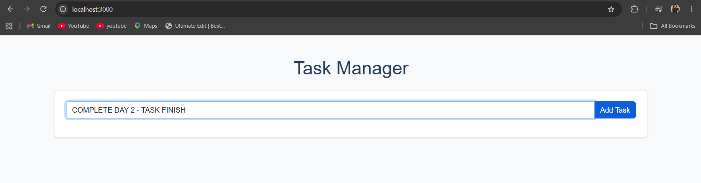

# Task Manager – End-to-End CI/CD Pipeline

## 📌 Project Overview

This project demonstrates an end-to-end CI/CD pipeline for a Node.js Task Manager web application using Jenkins, Docker, Docker Compose, and AWS EC2.

The project automates application deployment through Jenkins and performs post-deployment smoke testing to verify that the application is running successfully.

## 🛠️ Technologies Used

- **Node.js** – Backend application
- **MySQL** – Database
- **Docker** – Application containerization
- **Docker Compose** – Multi-container management
- **Jenkins** – CI/CD automation
- **AWS EC2** – Cloud deployment
- **Git & GitHub** – Version control

## ⚙️ CI/CD Pipeline Workflow

1. Developer pushes code to GitHub.
2. Jenkins fetches the latest source code.
3. Jenkins executes the pipeline.
4. Docker builds the application image.
5. Docker Compose deploys the application and MySQL database.
6. Jenkins performs a post-deployment smoke test.
7. Application becomes accessible through the EC2 public IP.

## 📸 Project Screenshots

### 1. Website Output

The Task Manager application running in the browser.

### 2. Application Working

Demonstration of the working Task Manager application.

## 📸 Project Screenshots

### 1. Website Output

### 2. Application Working

### 3. Database

### 4. Jenkins Deployment

### 5. Jenkins Smoke Test

## ✨ Key Features

- Automated CI/CD pipeline using Jenkins.
- Dockerized Node.js application.
- MySQL database integration.
- Multi-container deployment using Docker Compose.
- Application deployment on AWS EC2.
- Automated post-deployment smoke testing.

## 📚 Learning Outcomes

- Understanding CI/CD pipeline implementation.
- Working with Jenkins declarative pipelines.
- Building and managing Docker images and containers.
- Deploying multi-container applications.
- Managing cloud-based application deployment using AWS EC2.
- Implementing automated smoke testing.

## 👨‍💻 Author

**Nikhil**

Cloud & DevOps Enthusiast
